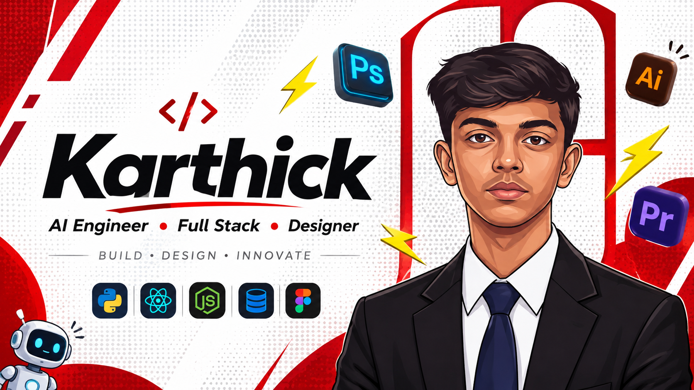

 

  

 

 

<table align="center">
<tr>
<td width="58%" valign="top">

| | |
|---|---|
| **Role** | AI Engineer / Full Stack Developer / Designer |
| **Education** | B.E. Computer Science and Engineering, 2028 |
| **Base** | India |
| **Completed** | MERN Stack, Flask, UI/UX Design |
| **Learning** | Web 3.0, Blockchain, Advanced Mobile Apps |
| **Obsessed with** | AI products, RAG systems, Developer tools |
| **Creative tools** | Photoshop, Illustrator, Premiere Pro, Figma |
| **Philosophy** | Build. Design. Innovate. |
| **Status** | Open to collaborate and build |

</td>
<td width="42%" align="center" valign="middle">

</td>
</tr>
</table>

 

 

FRONTEND 

BACKEND AND DATABASE 

MOBILE AND DESIGN 

LANGUAGES AND TOOLS 

 

 

<table>
<tr>
<td width="50%" valign="top">

### TEAMLINK
**Collaborative Team Management Platform**

Role-based security, task management, attendance tracking, team chat, AI assistance and productivity analytics.

</td>
<td width="50%" valign="top">

### MusicMix
**Multi-Variant Dance Remix Generator**

Automated DJ remix and mashup generator with phrase-level intermixes, crossfades, drum fills and multiple remix patterns.

</td>
</tr>
<tr>
<td width="50%" valign="top">

### BotNest AI
**No-Code AI Chatbot Builder**

Create knowledge-based chatbots from documents and websites with RAG, embeddings, hosted pages, iframe widgets and analytics.

</td>
<td width="50%" valign="top">

### AI Interview Helper
**Real-Time Interview Assistant**

Chrome extension offering live hints, explanations, solution approaches, grammar correction and contextual help in coding and HR rounds.

</td>
</tr>
<tr>
<td width="50%" valign="top">

### VANTAGE AI
**Master Your Interview**

High-fidelity AI interview simulator for students, career switchers and professionals to practice technical and behavioral rounds.

</td>
<td width="50%" valign="top">

### Quantum Predictor
**AI-Powered Financial Market Dashboard**

Track, compare and analyze global and Indian markets with live data, interactive charts, portfolio tracking and predictive signals.

</td>
</tr>
</table>

 

  

